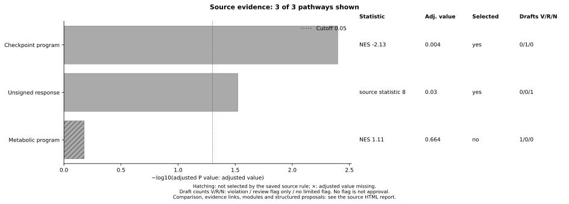

# Visualizing source evidence

The source HTML report is the detailed review surface. `plot-source` provides a
shareable overview of the same saved records, with separate displays for the
adjusted value, source statistic, statistical selection and draft-check counts.

```bash
llm-pathway-curator run \
  --evidence-table examples/source_report/evidence_table.tsv \
  --sample-card examples/source_report/sample_card.json \
  --claims examples/source_report/drafts.tsv --modules \
  --outdir out/source_report

llm-pathway-curator plot-source \
  --run-dir out/source_report --outdir out/source_plot
```

The example inputs are synthetic software demonstrations. Open
`out/source_plot/source_plot.png`, or use the PDF/SVG for a presentation.
`source_plot.tsv` contains the exact displayed source values and counts;
`plot_manifest.json` identifies the input report, source implementation and
plotting code by hashes. The report is checked against its saved receipt before
plotting. These are internal consistency checks, not independent attestations.
Use a new plot directory each time.



## Reading the plot

- Bar length is −log10 of the supplied adjusted value. It is not an accuracy or
  biological-importance score. The dotted line is the report's recorded cutoff.
- Color shows the source statistic. NES/ES use a signed color scale; other
  uniform statistic types use a sequential scale. Mixed statistic types use
  neutral bars and explicitly typed values, without a common color scale.
- Hatching marks records not selected by the saved statistical rule. This may
  reflect the cutoff, a missing adjusted value, or a top-K cap. The exact reason
  remains in the TSV. Missing statistics remain NA; missing adjusted values have
  an × at the origin. A reported zero adjusted value is retained as zero in the
  table and plotted at 300 on the −log10 scale.
- V/R/N counts are **flat submitted drafts** with a detected violation, a review
  flag without a detected violation, or no limited flag. Multiple drafts can
  share a source record. `no draft` is distinct from a checked text with no flag.
  A source selected by q does not imply that its prose is approved.

The default shows the first 50 records ordered by adjusted value, with missing
values last and source IDs breaking ties. `--top-n 0` shows all records. The
title and receipt state both the displayed and complete candidate counts.
Selection is read from the saved report, not recomputed by the plotter.

Use `report.html` for the comparison definition, exact source links, original
text, quoted findings, supporting-gene modules and structured proposals. The
plot's draft column does not combine structured proposals with flat drafts.
Modules describe gene overlap; they do not establish independent mechanisms.
No flag means neither correctness nor automatic acceptance.

## Packed circles and historical ranking

`viz_ranked.py` and the `plot-ranked` command remain available for complete
historical `claims_ranked.tsv` or audit-score inputs. Both packed circles and
bars are supported:

```bash
llm-pathway-curator plot-ranked \
  --in-tsv /path/to/claims_ranked.tsv --mode packed \
  --out-png out/ranked_packed.pdf --term-color-mode direction
```

These plots visualize the supplied ranking and module definitions. Utility,
context and stability scores are not probabilities of biological correctness.
Packed area applies the configured size transform (default exponent 3.5 and
minimum normalized size 0.03); area is not a linear effect-size measure.
Multiple nested runs require an explicit input path. Missing/nonfinite scores
are rejected, and missing audit factors are never replaced by 1.0.

The current `audit_log.tsv` describes source-statement eligibility and contains
no historical context/stability score. Use `plot-source` for these reports.
For pixel-level historical reproduction, use the original pinned code and data.

## Package responsibilities

| Purpose | Modules / entry point |
| --- | --- |
| Input conversion | `adapters/`, `adapt` |
| Source identity, statistical reporting and review | `review.py`, `grounding.py`, default `run` |
| Typed observations, support overlap and linked proposals | `curation.py`, `run --modules` / `--proposals` |
| Saved source visualization | `viz_source.py`, `plot-source` |
| Historical ranking and plots | `ranked.py`, `viz_ranked.py`, `rank` / `plot-ranked` |
| Historical analysis/model pipeline | `pipeline.py` with `workflow="legacy"` |
| Manuscript-specific analyses and figures | `paper/scripts/`, `paper/revision/CRM_R1/` |

The source and historical routes remain explicit; public imports are retained.
Manuscript panels have their own data-to-code map in `paper/FIGURE_MAP.csv`.
An exploratory visualization is a tool feature, not a new evaluation result.
